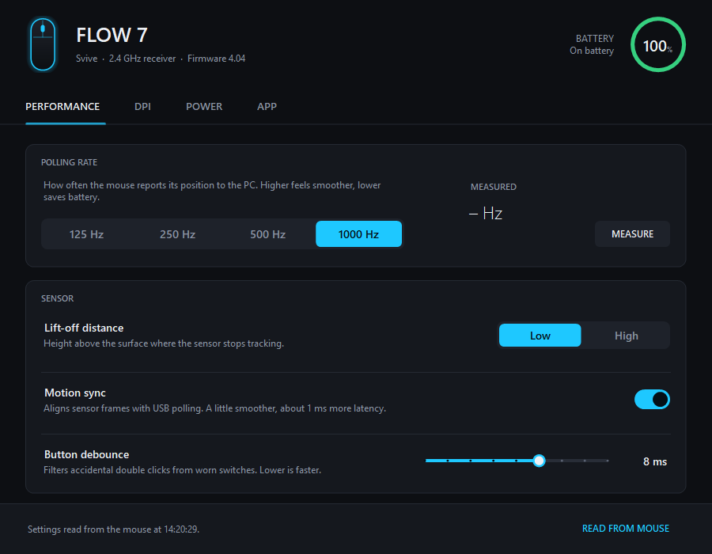
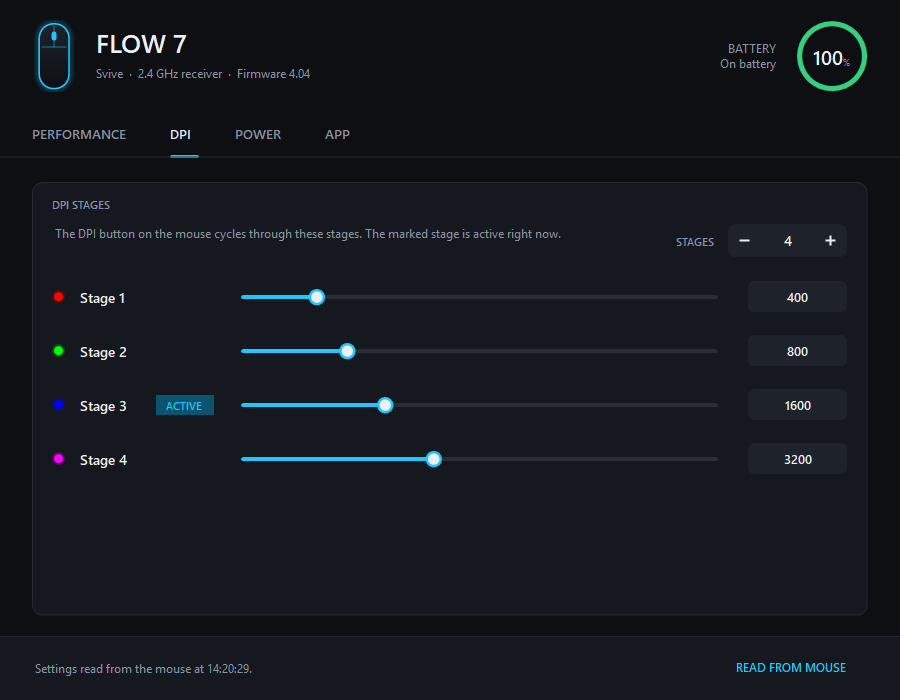
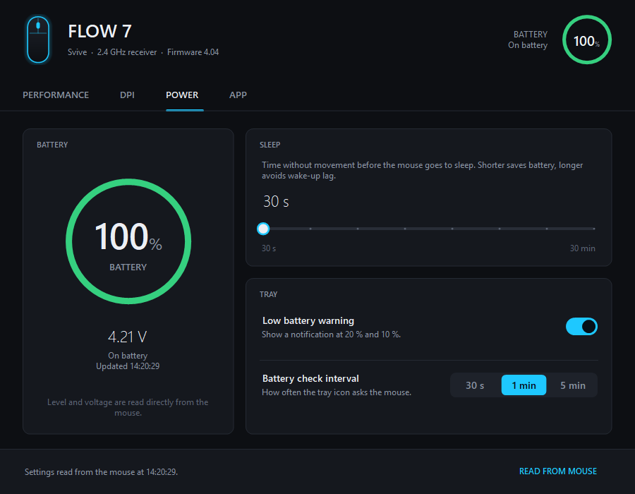

<p align="center">
  
</p>

<h1 align="center">CompxTray</h1>

<p align="center">
  <b>Unofficial software for the Svive Flow 7 wireless gaming mouse.</b><br>
  Battery level in the tray, plus DPI, polling rate, lift-off, debounce and sleep settings.<br>
  Free and open source for Windows 10 and 11. Works with other Compx-based mice too.
</p>

<p align="center">
  <a href="../../releases/latest"><b>Download</b></a> ·
  <a href="#på-svenska-programvara-för-svive-mus">På svenska</a> ·
  <a href="#faq">FAQ</a>
</p>

<p align="center">
  
</p>

## Software for the Svive Flow 7

The Svive Flow 7 is a light wireless gaming mouse with a 2.4 GHz receiver. When this project started, we could not find any official software for it, so there was no way to see the battery level or change DPI, polling rate or sleep settings from Windows. CompxTray fills that gap. It talks to the mouse through its receiver, shows the battery level in the tray, and lets you change the same settings that gaming mouse software from other brands offers.

## Features

- **Battery in the tray.** The tray icon shows the battery percentage and changes colour as the battery drains. It also shows when the mouse is charging or asleep.
- **Low battery warnings** at 20 % and 10 %, and a note when the mouse is fully charged.
- **Polling rate** 125 / 250 / 500 / 1000 Hz, with a built-in tool that measures the rate the mouse actually reports at.
- **DPI stages.** Set how many stages the mouse has (1 to 6) and the DPI of each, from 100 to 30 000 in steps of 50.
- **Sensor:** lift-off distance, motion sync and button debounce.
- **Sleep timer** from 30 seconds to 30 minutes.
- **Safe writes.** CompxTray reads every change back from the mouse to verify it. It also saves a backup of the original settings the first time it reads a mouse, and you can restore them with one click.
- **Lightweight.** A single small `.exe` with no installer, no account and no network access. It runs on the .NET Framework that comes with Windows 10 and 11.

| | |
|---|---|
|  |  |

## Supported devices

| Mouse | Receiver ID | Battery | Settings |
|---|---|---|---|
| Svive Flow 7 | `373B:11B3` | ✅ | ✅ verified |
| Svive Flow 5, Flow S5, Flow S7 | not tested | probably ✅ | read-only until verified |
| Other Compx mice (`373B:*`, `3554:*`) | | likely ✅ | read-only until verified |

Do you have another Svive mouse? Run CompxTray and see if the battery shows up, then [help verify it](#adding-a-mouse). Many mice from VXE, ATK, Attack Shark and other brands also use Compx chips. Battery reading uses the same command across the family, so it will probably work on them too. Settings are **only writable on verified models**, because some Compx firmwares lay out their memory differently. See [Adding a mouse](#adding-a-mouse).

### What has been tested on the Flow 7

All of this was checked on real hardware with the guided test in `tools\verify-writes.bat`:

| Setting | Written and read back | Effect confirmed |
|---|---|---|
| Polling rate | ✅ | ✅ measured 500 and 1000 Hz |
| DPI values | ✅ | ✅ pointer speed changes immediately |
| Number of DPI stages | ✅ | ✅ the DPI button cycles through an added stage |
| Active stage display | ✅ | ✅ follows the DPI button live |
| Lift-off (Low / High) | ✅ | ✅ Low stops tracking closer to the surface |
| Debounce | ✅ | ✅ clicks behave normally at 2 ms |
| Motion sync | ✅ | not visible to the eye |
| Sleep timer | ✅ | ✅ |
| Settings after power off | ✅ | ✅ all kept |
| Restore original settings | ✅ | ✅ |

## På svenska: programvara för Svive-mus

**CompxTray är en gratis, inofficiell programvara för Svive Flow 7.** Med den ser du batterinivån på din Svive-mus direkt i aktivitetsfältet och kan ändra musens inställningar i Windows, något som annars saknas för den här musen.

Det här kan du göra:

- **Batterinivå:** procent i aktivitetsfältet, med varning när batteriet börjar ta slut och besked när musen är fulladdad.
- **DPI:** antal DPI-steg (1 till 6) och DPI för varje steg, från 100 till 30 000.
- **Polling rate:** 125, 250, 500 eller 1000 Hz, med en inbyggd mätning av vad musen faktiskt skickar.
- **Övriga inställningar:** lift-off distance, debounce, motion sync och viloläge (30 sekunder till 30 minuter).
- **Säkerhet:** allt läses tillbaka från musen efter varje ändring, och originalinställningarna sparas så att du kan återställa dem.

**Så kommer du igång:** ladda ner `CompxTray.exe` under [Releases](../../releases/latest) och starta den. Dubbelklicka på batteriikonen nere vid klockan för att öppna inställningarna. Appen är på engelska.

**Mac och Linux:** det finns en förhandsversion för macOS och Linux som visar batterinivån i menyraden eller aktivitetsfältet och musens inställningar (bara läsning än så länge). Den är ännu inte testad på en riktig Mac eller Linux-dator. Se [macOS and Linux](#macos-and-linux-preview).

### Vanliga frågor

**Finns det någon programvara till Svive Flow 7?**
Vi hittade ingen officiell programvara eller drivrutin för inställningar när projektet startade. Musen fungerar utan drivrutin i Windows, men för att se batteriet eller ändra DPI och polling rate behöver du ett program som CompxTray.

**Hur ser jag batterinivån på min Svive-mus?**
Starta CompxTray. Batteriet visas i procent i aktivitetsfältet och uppdateras automatiskt.

**Kan jag ändra DPI och polling rate på Svive Flow 7?**
Ja. Öppna CompxTray, välj fliken *Performance* för polling rate och *DPI* för DPI-stegen, och klicka *Apply*.

**Fungerar det med Svive Flow 5, Flow S5 eller Flow S7?**
Troligen för batteriet, eftersom de verkar bygga på samma typ av chip, men det är inte testat. Inställningarna går bara att läsa tills modellen är verifierad. Har du en sådan mus får du gärna [hjälpa till att testa](#adding-a-mouse).

**Är CompxTray från Svive?**
Nej. Det är ett fristående hobbyprojekt med öppen källkod och har ingen koppling till Svive.

## FAQ

**Is there official software for the Svive Flow 7?**
When this project started, we could not find any official software or settings driver for the Flow 7. The mouse works in Windows without a driver, but to see the battery level or change DPI and polling rate you need a tool like CompxTray.

**How do I check the battery level of my Svive mouse?**
Run CompxTray. The battery percentage is shown in the tray and updates automatically.

**Can I change the DPI and polling rate of the Svive Flow 7?**
Yes. Open CompxTray, use the *Performance* tab for the polling rate and the *DPI* tab for the DPI stages, then click *Apply*.

**Does it work with the Svive Flow 5, Flow S5 or Flow S7?**
Probably for the battery level, since they appear to use the same kind of chip, but they have not been tested. Settings stay read-only until a model is verified. If you own one, please [help verify it](#adding-a-mouse).

**Is CompxTray made by Svive?**
No. It is an independent open-source project with no connection to Svive.

## Install

1. Download `CompxTray.exe` from [Releases](../../releases).
2. Run it. The battery icon appears in the tray.
3. Double-click the tray icon to open the settings. To start CompxTray automatically, use *App → Start with Windows*.

### About the SmartScreen warning

The first time you run it, Windows may show *"Windows protected your PC"*. The exe is not code-signed yet, and SmartScreen warns about new, unknown programs until enough people have run them. To check the file before you run it:

- **GitHub builds it, not a person.** Every release exe is built by GitHub Actions from the source in this repository. You can read the build log for each release.
- **Compare the checksum.** The SHA-256 checksum is published next to the exe in the release. Compare it with `Get-FileHash CompxTray.exe` in PowerShell.
- **Or build it yourself.** Run `build.bat` (below). A file you build yourself never triggers SmartScreen.

To run a downloaded release: *More info → Run anyway*. Code signing through [SignPath Foundation](https://signpath.org) is planned once the project qualifies.

Settings, the log and backups are stored in `%APPDATA%\CompxTray`.

## macOS and Linux (preview)

A separate build for macOS and Linux shows the battery level in the menu bar or tray, with low battery notifications, and a window with the mouse's settings. Settings are **read-only** in this version. It shares the protocol code with the Windows app and has been tested against a real Svive Flow 7 on Windows, but **it has not been tested on a Mac or a Linux PC yet**. If you try it, please open an issue with what you see and the output of `compxtray-cli devices`.

| Download from [Releases](../../releases/latest) | For |
|---|---|
| `CompxTray-osx-arm64.zip` | Macs with Apple silicon (M1 and later) |
| `CompxTray-osx-x64.zip` | Intel Macs |
| `CompxTray-linux-x64.tar.gz` | 64-bit Linux (x86-64) |

**macOS:** unzip and move `CompxTray.app` to *Applications*. The app is not notarized by Apple, so macOS blocks it the first time you open it. Go to *System Settings → Privacy & Security* and click *Open Anyway*. If macOS asks for *Input Monitoring*, allow it so CompxTray can reach the receiver. The log is in `~/Library/Application Support/CompxTray`.

**Linux:** unpack the archive and run `./install.sh`. It copies CompxTray to `~/.local/bin`, adds it to your applications menu and installs a udev rule (asks for your password) so you can open the receiver without root. Unplug and replug the receiver afterwards. The tray icon needs a desktop with StatusNotifier support: KDE Plasma, Xfce, Cinnamon and Ubuntu work out of the box, and on plain GNOME you need the *AppIndicator and KStatusNotifierItem Support* extension. The log is in `~/.config/CompxTray`.

Both packages include `compxtray-cli`, a read-only command-line tool:

| Command | What it shows |
|---|---|
| `compxtray-cli battery` | Battery level, charging state and voltage |
| `compxtray-cli settings --wait 30` | DPI stages, polling rate, lift-off, debounce, motion sync and sleep. `--wait` keeps trying while the mouse is asleep |
| `compxtray-cli diagnose` | Raw replies and the settings memory, for bug reports |
| `compxtray-cli devices` | The receiver's HID interfaces, for bug reports |

To build it yourself you need the [.NET 10 SDK](https://dot.net). On Linux run `sh cross/linux/package.sh linux-x64 1.1.0`, on a Mac `sh cross/macos/package.sh osx-arm64 1.1.0`. The result ends up in `out/`.

## Build from source

You don't need Visual Studio or an SDK. The C# compiler that ships with Windows (.NET Framework 4.x) is enough.

```bat
git clone <this repository>
cd CompxTray
build.bat
```

`build.bat` compiles `bin\CompxTray.exe` and starts it. `build.bat --ci` only builds; GitHub Actions uses it to build every push and to attach the exe to tagged releases.

Other command-line options:

| Option | What it does |
|---|---|
| `--open` | Start in the tray and open the window |
| `--demo` | Open the window with sample data, no mouse needed and nothing is written |
| `--screenshot <dir> [--demo]` | Save one PNG per tab (used for the images above) |

## How it works

The USB receiver exposes a vendor-specific HID interface (usage page `0xFF02`) with 17-byte reports. CompxTray sends small commands on it: read battery, read memory and write memory. It then reads and writes the mouse's settings memory directly, with the same checksummed values the mouse already stores. The full details are in [docs/PROTOCOL.md](docs/PROTOCOL.md).

## Adding a mouse

If you have another Compx-based mouse, you can help verify it. The first two tools only read.

1. Run `tools\probe.ps1`, which lists your HID devices.
2. Run `tools\read-settings.ps1`, which dumps and decodes the settings memory. Check that the decoded DPI stages and polling rate match what the mouse is set to.
3. Only if step 2 matches, run `tools\verify-writes.bat`. It changes each setting, asks what you notice, and restores everything at the end.
4. Open an issue with the reports.

```bat
powershell -NoProfile -ExecutionPolicy Bypass -File tools\read-settings.ps1
```

If the memory matches the known layout, the model can be added to the verified list in `src/Device/ConfigMap.cs`.

## Project layout

```
src/Device/   protocol, memory map, read/write/verify logic (shared with cross/), and WinHid.cs, the Windows HID transport
src/UI/       dark theme and owner-drawn controls, settings window
src/          tray app, app settings, entry point
cross/        the macOS and Linux build (.NET 10): Core (HidSharp transport), App (Avalonia), Cli, packaging
tools/        diagnostics and the guided hardware test
docs/         protocol notes, screenshots and the project website (GitHub Pages, English and Swedish)
```

## Credits

The protocol was pieced together from public reverse-engineering work by others. Thank you:

- [atkctl](https://github.com/xiehuc/atkctl) (MIT): Compx frame format and commands
- [OpenMouse mouse-protocol](https://github.com/OpenMouse-Project/mouse-protocol) (AGPL-3.0): the A9-family memory map and value encodings
- [MouseBattery](https://github.com/zhijuyingfeng/MouseBattery) and [atk-mouse-battery](https://github.com/wow-233/atk-mouse-battery): the battery command

CompxTray's code is written from scratch; only protocol facts were taken from these projects. The memory map was confirmed by reading a real Svive Flow 7.

The macOS and Linux build uses [HidSharp](https://software.seekye.com/hidsharp) (Apache-2.0) for USB access and [Avalonia](https://avaloniaui.net) (MIT) for the interface.

## Disclaimer

CompxTray is an independent project. It is not affiliated with or endorsed by Svive, Compx or any mouse manufacturer, and product names are trademarks of their owners. Changing settings writes to your mouse's memory. CompxTray verifies every write and keeps a backup, but you use it at your own risk.

## License

[MIT](LICENSE)

